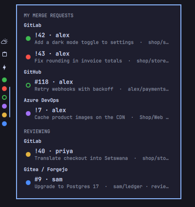

# Akari Kopa

*Akari* is Japanese for a light, *kopa* is Setswana for to ask or request: a light for each of your requests.

One coloured orb per open merge request, in your bar or system tray, so you see when a pipeline breaks without opening a browser.



| Orb | Meaning |
|---|---|
| green / red | your merge request, pipeline passed / failed; green too when it has no pipeline |
| purple | yours, and someone left comments you have not resolved or answered; a failed pipeline still shows red |
| blue / yellow | one you are reviewing, pipeline passed / failed |
| ring | pipeline still running |

Hover shows the number and author; a click lists them and opens one. In the list, ↑ and ↓ move between them, wrapping round at either end, Enter opens the one lit, and Esc closes it. A pipeline waiting on manual jobs counts as passed. An orb leaves once its merge request merges or closes.

A merge request to a repository you cannot push to shows for its first three days, then steps aside: maintainers there answer when they answer. It is looked at again on days 5 and 7, then weekly, and comes back only if comments are waiting for you. On day 31 it is let go.

## Omarchy

```sh
omarchy plugin add https://github.com/Libertas-le-Spes/akari-kopa.git --enable
omarchy bar put kayu.akari-kopa --section center
```

For the `akari-kopa` command, its short form `akari`, and the Super + Ctrl + M shortcut to the list:

```sh
mkdir -p ~/.local/bin
ln -s ~/.config/omarchy/plugins/kayu.akari-kopa/backend/bin/akari-kopa ~/.local/bin/akari-kopa
ln -s ~/.config/omarchy/plugins/kayu.akari-kopa/backend/bin/akari-kopa ~/.local/bin/akari
akari shortcut
```

`ln -s` stops rather than replace a command you already have by either name.

To update, then restart the bar, which only loads a plugin's new code when it starts:

```sh
omarchy plugin update kayu.akari-kopa
omarchy-restart-shell
```

The update shows what changed and asks before it applies anything. The plugin runs as you, next to your forge logins, so read the change before you say yes.

To remove it, take the shortcut and the commands out, then the plugin:

```sh
akari remove-shortcut
rm -f ~/.local/bin/akari ~/.local/bin/akari-kopa
omarchy plugin remove kayu.akari-kopa --yes
```

## Any other Linux desktop

A system tray icon per merge request, for KDE, XFCE, Cinnamon, MATE, Budgie, Waybar, and GNOME with the AppIndicator extension.

```sh
git clone https://github.com/Libertas-le-Spes/akari-kopa.git ~/.local/share/akari-kopa
~/.local/share/akari-kopa/install.sh
akari tray &
```

`akari` is the short form of `akari-kopa`. It is not `kopa`, because an AUR clipboard manager already installs a command by that name.

It starts with your session from then on, and Super + Ctrl + M opens a list of your merge requests; pick one to open it. The shortcut is set the way your desktop keeps its own: KDE Plasma, GNOME, Budgie, Cinnamon, MATE, Xfce, Hyprland and Sway. The list needs zenity. `install.sh --remove` undoes all of it.

## Services

Each service is read through the tool you already log in with.

| Service | Log in with |
|---|---|
| GitLab, including self-hosted | `glab auth login` |
| GitHub, including Enterprise | `gh auth login` |
| Gitea, Forgejo, Codeberg | `tea login add` (tea 0.12 or newer) |
| Azure DevOps | `az login` (the Azure CLI), below |

For Azure DevOps, log in to the Azure CLI with the account you use there:

```sh
az login --allow-no-subscriptions
```

`--allow-no-subscriptions` lets an account that uses Azure DevOps but no other Azure service log in. Every organisation you belong to is read, and a pull request's pipeline is the builds Azure Pipelines ran for it.

When a service cannot be reached, its last answer stays on show, faded, with the reason in the list.

Akari Kopa only reads, so it needs no more than a read-only login: for GitLab, a token with only `read_api` (`glab auth login` lets you paste one); for Azure DevOps, a token with only Code (Read) and Build (Read). GitHub has no read-only login that covers private repositories across several owners, so `gh` keeps its usual login.

A merge request opens only when its address is an `https` page on the forge it came from; any other address is shown with the reason and opens nothing.

On a machine other people log in to, mount `/proc` with `hidepid=invisible`: on Linux, any account can otherwise read the command line of your programs, and `tea` puts repository names in its own.

## Needs

Python 3.10 or newer. The tray also needs PyGObject (`python3-gi`, `python3-gobject` or `python-gobject`); `install.sh` names whatever is missing.

## Adding a service

Add a class to `backend/akari_kopa/adapters/services/` that says whether it is set up and returns the merge requests it finds, and list it in `backend/akari_kopa/wiring.py`. Nothing else changes.

## Tests

```sh
cd backend && python3 -I -m unittest
```
